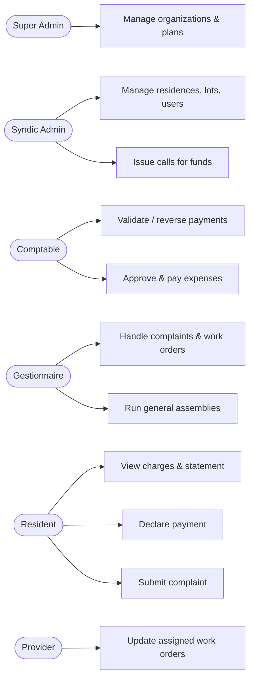
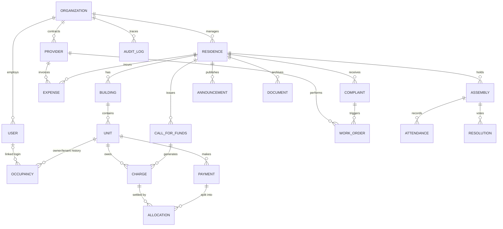
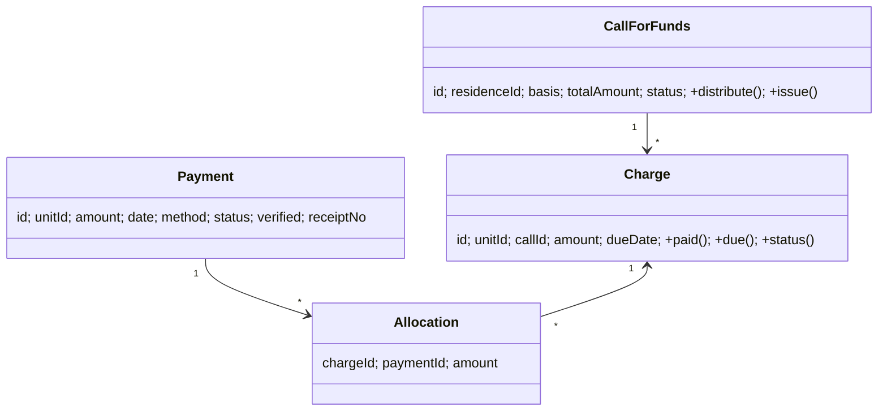
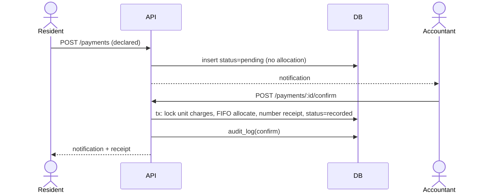
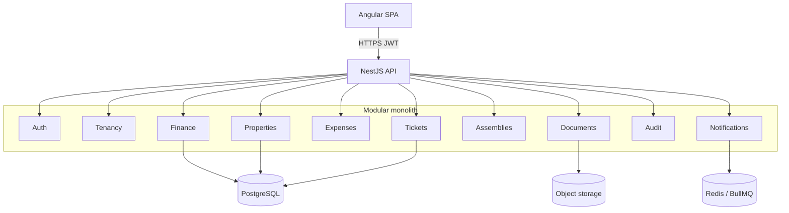
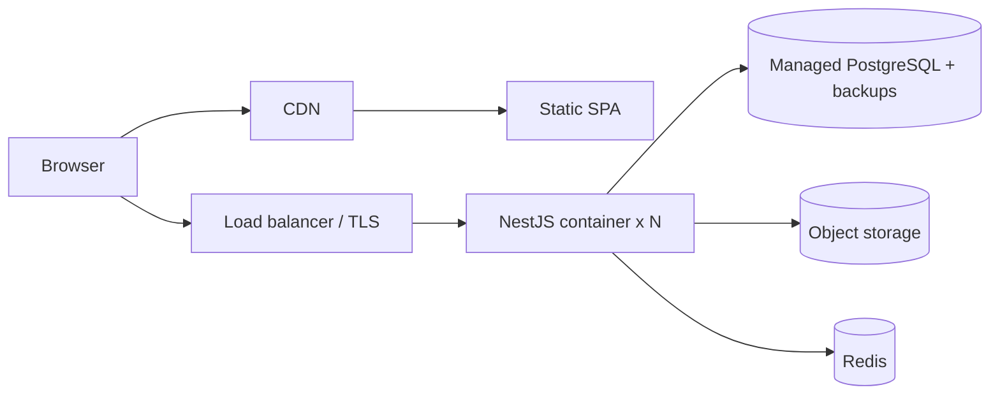

# Architecture & UML (Phase 3 draft)

Diagrams are Mermaid (render on GitHub). They describe the **target** NestJS/PostgreSQL system, derived from the Phase 1 data model.

## Use cases

## ERD

## Class diagram (finance core)

## Sequence — declare then validate a payment

## Components

## Deployment

## Invariants & isolation
- Every tenant-owned table has `org_id`; every query is scoped by it (guard + repository filter + PostgreSQL row-level security as defence in depth).
- Money: `numeric(14,2)`; `charge.paid` derived from `allocation`; unique `(org_id, receipt_no)`; payments immutable once `recorded` (reverse via compensating state + reason).
- Audit log append-only (no UPDATE/DELETE grants).
- Legal items needing professional verification: quorum/majority rules (Law 18-00 as amended by 106-12), personal-data processing and CNDP declaration (Law 09-08).
